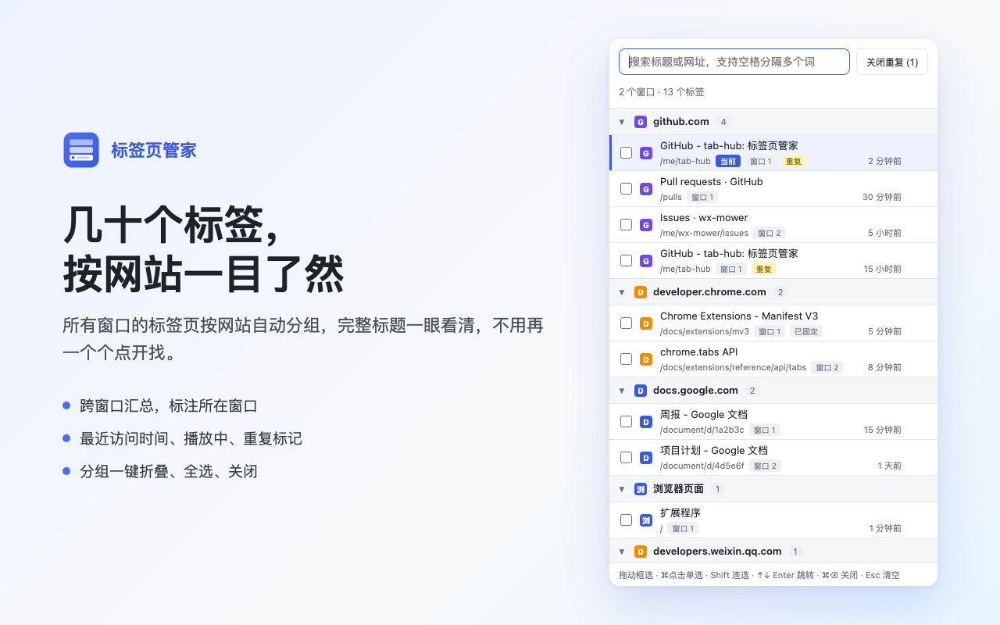
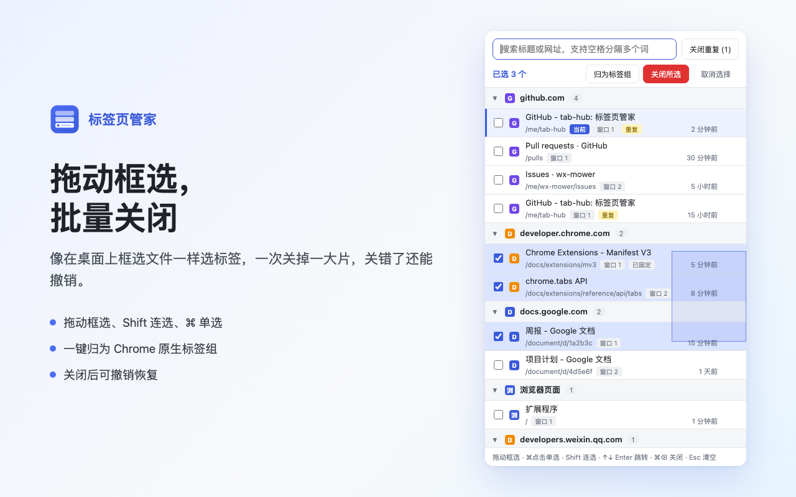
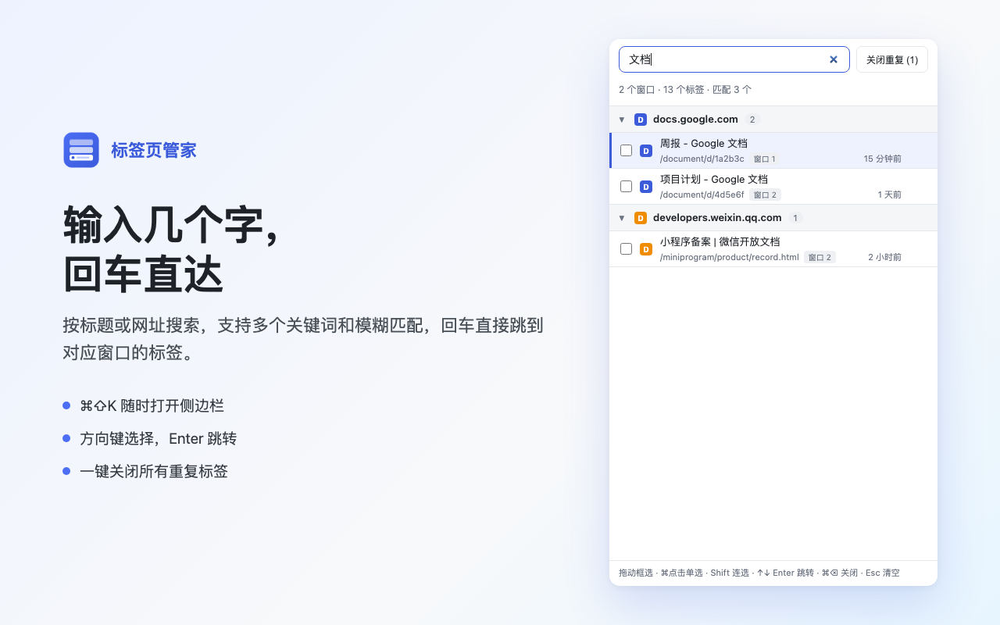

# 从一句话想法到上架 Chrome 商店：AI 5 分钟写完「标签页管家」，剩下 1 小时全在填这些坑

> **TL;DR**
> 作为一个干了十几年 Java 的后端，我以前从没写过浏览器扩展。最近因为受够了 Chrome 开几十个标签页找不到东西，我和 AI 花 5 分钟写出了第一版「标签页管家」，并最终上架了 Chrome 应用商店。
>
> 很多人以为用 AI 做独立产品就是“一句话生成代码，直接发布”。但真实跑完整个闭环就会发现：**AI 把写代码的成本压到了 5 分钟，而把“本地能跑的玩具”变成“全球商店里人人敢装的产品”，中间隔着产品减法、容器选型、自动化自检和上架合规四道关卡。**
>
> 本文不记流水账，只复盘这次把后端工程思维迁移到 Chrome 插件开发里的 **4 个核心设计决策**，以及文末附上的一份**可直接抄的插件开发与上架避坑清单**。
>
> 🔗 **Chrome 商店安装**：[标签页管家（Tab Hub - Tab Manager）](https://chromewebstore.google.com/detail/%E6%A0%87%E7%AD%BE%E9%A1%B5%E7%AE%A1%E5%AE%B6/nbpkhbblgfcboimbofbeipbnoabbpfbi?hl=zh-CN&utm_source=ext_sidebar)
> 🌐 **产品主页**：[https://ganhuo.dev/tab-hub/](https://ganhuo.dev/tab-hub/)

---

## 一、产品边界：为什么第一版主动砍掉了“AI 网页摘要”？

日常排查线上问题、看文档、查资料时，我的 Chrome 经常同时开着三四个窗口、四五十个标签页。顶部的标签栏被挤得只剩下一排小图标，想找半小时前看过的某个页面，只能挨个点开，或者干脆重新开一个——结果重复标签越攒越多。

起初我的想法很丰满：做一个按网址自动归组的插件，**给每个标签页生成一段当前网页内容的简介**，再支持**用 Mac 触控板三指滑动批量选中**、一键关闭。

但在动手写第一行代码前，我和 AI 先做了一次**权限与投入产出比的对账**，当场砍掉了两个听起来很酷的设计：

| 最初想法 | 为什么看起来很美 | 工程与合规代价 | 最终决策 |
| :--- | :--- | :--- | :--- |
| **每个标签页显示网页正文摘要** | 不用点开标签，看一眼摘要就知道里面写了什么 | 读标题和网址只需 `tabs` 权限；一旦要读网页正文，必须申请 `<all_urls>`（读取所有网站数据）或注入脚本。**审核周期直接拉长数倍，且安装时弹窗提示“可读取您在所有网站上的数据”，极易劝退用户** | **果断砍掉**。改用“完整标题 + URL 路径 + 所在窗口 + 多久前访问 + 状态标记（播放中/固定/重复）”组合呈现，信息量足够且零隐私侵入 |
| **捕获三指滑动手势做批量选中** | 手指一划就能勾选一串标签，交互很爽 | 浏览器扩展跑在沙箱里，根本拿不到 macOS 系统级的三指触控板原始事件 | **换思路平替**。在界面里实现标准的“按住鼠标拖动框选”；Mac 用户只要开启系统自带的“三指拖移”，三指一滑天然就是批量框选 |
| **一键清理重复标签** | 同一个文档开四五个窗口是常态 | 只需纯内存比对 URL，但直接删容易误杀正在看或固定的标签 | **做，但加上保护策略**：忽略 `#hash` 锚点差异，按 **“已固定 > 当前激活 > 最近访问”** 优先级保留唯一一个，且结合 `sessions` 权限提供一键撤销 |

> **可带走的经验**：AI 时代做产品，最难的不是“怎么实现”，而是**克制**。AI 可以轻易帮你写出注入网页抓取正文的代码，但它不会替你承担用户看到高危权限警告时的卸载率。**用最小权限（只读标签元信息、不碰正文、不联网）换取最低的用户信任门槛和最快的商店过审速度，是独立工具冷启动最优的解法。**



---

## 二、容器选型：为什么关掉一组标签，插件把“自己”也关了？

第一版代码 AI 只用 5 分钟就写完了，采用的是浏览器插件最经典的 **Popup（点击图标弹出小窗口）** 形态。

可当我把它加载进浏览器真机试用时，立刻撞上了一个诡异的现象：**点分组右侧的“关闭整组”时，有时候插件好好的，有时候插件窗口会突然自己消失，连带底部的“已关闭 N 个标签 · 撤销”按钮也一起没了。**

起初我以为是关闭标签的异步回调写出了 Bug。排查后才发现，这是**容器生命周期与业务场景的根本冲突**：

```
Chrome Popup 的原生机制：
Popup 绑定在当前窗口的「激活标签页（Active Tab）」上。
只要 Active Tab 发生切换 ──→ Chrome 立即强制销毁 Popup 窗口。
```

- 当你关闭的那组标签都在后台或别的窗口时，当前激活标签没变，Popup 安然无恙；
- 当你关闭的那组标签里**恰好包含你当前正在看的这一页**时，该页被关的瞬间，Chrome 会自动把焦点切给相邻标签——激活标签一变，Popup 当场陪葬，用户连点“撤销”反悔的机会都没有。

看清这一层，就知道在 Popup 里修修补补是死胡同。标签页管理本质上是**跨标签、跨窗口的连续高频操作**，它的宿主容器必须与单个标签页的焦点生命周期解耦。

于是我们花了 2 分钟把架构彻底切到了 Manifest V3 的 **Side Panel（侧边栏）**：
1. **常驻不销毁**：侧边栏固定在浏览器右侧，无论怎么切换标签、关闭当前页、甚至跨窗口跳转，面板始终保持打开，撤销提示条永远在线；
2. **窄屏自适应**：Popup 可以写死 760px 宽，而侧边栏默认只有 360px 左右。我们将布局改为弹性自适应，把分组上的“全选 / 归组 / 关闭整组”按钮改为悬停按需展示，避免窄屏下挤掉域名。



> **可带走的经验**：AI 写第一版时，往往会顺着最常见的模板（Popup）往下写。**代码的逻辑正确性可以交给单测，但“宿主容器的生命周期是否匹配真实交互”，只有人装进真机点上几下才能做出判断。**

---

## 三、工程底座：没有界面的命令行 AI，怎么保证前端不翻车？

很多人好奇：Claude Code 跑在终端命令行里，既不能像人一样自己点开 Chrome 扩展弹窗，也看不到样式错位，为什么它能 5 分钟写完核心功能、2 分钟改完侧边栏布局，还能在打包时自己拦截低级错误？

答案很简单：**按后端工程化的路子，把前端插件拆成“纯逻辑单测 + 无头浏览器视觉自检 + 打包静态门禁”三层底座。**

```
┌─────────────────────────────────────────────────────────────┐
│ 1. 纯逻辑层 (lib/core.js)                                   │
│    域名归并、多词加权搜索、URL 归一化查重 → Node 单测秒级验证 │
├─────────────────────────────────────────────────────────────┤
│ 2. 视觉自检层 (dev/preview.html + Headless Chrome)          │
│    Mock chrome.* 接口与极端状态数据 → 自动渲染截图供 AI 审图  │
├─────────────────────────────────────────────────────────────┤
│ 3. 打包门禁层 (pack.sh)                                     │
│    静态扫描代码中的 i18n Key → 与 zip 内多语言包做差集校验    │
└─────────────────────────────────────────────────────────────┘
```

### 1. 剥离纯逻辑：不启动浏览器也能测完边界

如果把分组、搜索、查重写在 DOM 事件里，每次改一行都要去浏览器手动点刷新。我们将所有核心算法抽进了零依赖的 `lib/core.js`，比如多关键词加权搜索（标题前缀命中 > 标题子串 > 域名命中 > 字符顺序模糊匹配）和 URL 查重规则，直接用 `node test/core.test.mjs` 验证所有边界用例。

### 2. 伪造运行环境：让 AI 自己“截屏看图”调 CSS

为了让命令行里的 AI 能“看见”自己写的界面，我们建了一个 `dev/preview.html` 预览沙箱：在页面里用几十行代码 Mock 掉 `chrome.tabs` 和 `chrome.windows`，塞入包含“超长标题、播放中、已固定、已休眠、重复页、跨窗口”的模拟数据。

每次改完样式，AI 直接调用本机 Chrome 的无头模式（`--headless=new --screenshot`）生成默认、框选、搜索三种状态的 PNG 图，再用读图工具自己检查像素级排版。从 760px 弹窗改到 360px 侧边栏时，域名被截断成 `github....` 的问题，就是它看图自检时发现并修掉的。



### 3. 把踩过的坑变成打包门禁：防漏打语言包

在决定面向海外市场改成中英双语（`_locales/en` 与 `_locales/zh_CN`）后，我们第一次上传商店就被拒了，报错：

```text
default_locale field is missing in manifest.
```

实际上 `manifest.json` 里明明写了 `"default_locale": "en"`。真凶是打包脚本 `pack.sh` 显式列出了要打包的文件名，改双语时新增了 `_locales/` 目录，却忘了加进 `zip` 命令参数里——商店在包里找不到默认语言包，抛出了一个极具误导性的报错。

为了彻底杜绝“漏打目录”或“代码加了新文案、某国语言包忘了翻译”，我们直接在 `pack.sh` 里加了一段 Python 自检门禁：

```bash
# 1. 只打包运行时必需文件，排除 dev/ test/ store/
zip -r -X "$OUT" manifest.json background.js popup.html popup.css popup.js lib icons _locales -x "*.DS_Store"

# 2. 静态门禁：校验 zip 内语言包完整性，确保代码引用的每个 key 在所有语言包中都存在
python3 - "$OUT" <<'EOF'
import json, re, sys, zipfile
z = zipfile.ZipFile(sys.argv[1])
names = set(z.namelist())
manifest = json.loads(z.read('manifest.json'))
locales = sorted({n.split('/')[1] for n in names if n.startswith('_locales/') and n.endswith('messages.json')})
default = manifest.get('default_locale')
assert default in locales, f'包里缺少默认语言包 _locales/{default}/messages.json'

used = set(re.findall(r'__MSG_(\w+)__', json.dumps(manifest)))
used |= set(re.findall(r"\bt\('(\w+)'", z.read('popup.js').decode()))
used |= set(re.findall(r'data-i18n(?:-placeholder)?="(\w+)"', z.read('popup.html').decode()))
for loc in locales:
    msgs = json.loads(z.read(f'_locales/{loc}/messages.json'))
    missing = sorted(used - set(msgs))
    assert not missing, f'{loc} 语言包缺少：{missing}'
print(f'自检通过：语言包 {locales}，共检查 {len(used)} 条文字')
EOF
```

> **可带走的经验**：不要用人的记忆力去对抗重复流程。**凡是在发布环节踩过一次的坑，立刻写进打包脚本变成 `assert` 断言**，以后少翻一个词、漏打一个目录，本地打包阶段就会直接报错拦下。

---

## 四、走出本地：从“能跑的代码”到“合规上架的商品”

代码写完打包好，距离真正上架 Chrome Web Store 还有最后一公里。这一公里不考编程，考的是对**数据脱敏、全球化分发和平台合规**的把控。

### 1. 警惕 AI 的“贴心”：测试与截图数据脱敏

这是整个上架过程中最惊险的一幕。
AI 在写 `dev/preview.html` 预览页和单测用例时，为了让我看着有代入感，顺手从过往对话上下文里抓了我平时工作常提的**公司内部文档域名和业务名词**当模拟数据。

等到生成 1280×800 的商店宣传图时，这些内网域名赫然印在了高清大图上！所幸在读图复核阶段及时发现，把代码和单测里的模拟数据全部替换成了 GitHub、Google Docs、Hacker News 等通用域名。

这里还附带一个**无头浏览器的缓存暗坑**：改完源码里的模拟数据重新跑截图命令，截出来的图居然还是旧的内网域名——因为 Headless Chrome 默认复用了临时 Profile 目录下的页面缓存。最后通过每次截图指定全新的 `--user-data-dir` 并附加时间戳查询参数，才彻底清理干净。

### 2. 第一天就要做双语（Day-1 i18n），而不是只改个英文标题

填商店表单时，我原本想偷个懒：界面先保留中文，只把商店标题改成中英双语。
但仔细一想就会发现问题：Chrome 商店是全球统一分发的，如果一个海外用户搜英文关键词装上了你的插件，点开一看按钮和提示全是中文，他不会等你的下一个版本，只会在 10 秒内卸载并留下一条一星差评。**早期评分一旦被拉低，权重就很难再爬起来。**

用 Chrome 原生的 `_locales` 机制做双语其实非常轻：
- 代码里抽离 46 个文案 key，中文环境展示 **“标签页管家”**，其他所有语言环境默认展示 **“Tab Hub - Tab Manager”**；
- 商店后台在默认的 `English` 视图下把英文截图传到 `Global screenshots`（全局默认图），再切到 `中文（简体）` 视图把中文截图传到 `Localized screenshots`（特定语言覆盖图）。两边用户逛商店时看到的都是母语界面。

### 3. 把每个独立小产品沉淀为个人域名资产

申请了 `tabs` 权限的插件，商店强制要求提供公开可访问的隐私政策链接（Privacy Policy URL）。
与其随便挂一个裸的 GitHub Pages 临时链接，我选择了直接复用自己的技术博客域名 `ganhuo.dev`（基于 Astro 构建，Git Push 后由 Cloudflare Pages 自动部署）：

- 隐私政策页：`https://ganhuo.dev/tab-hub/privacy/`（中英双语对照，明确声明数据仅在浏览器内存处理、不落盘、不上传）；
- 产品介绍页：`https://ganhuo.dev/tab-hub/`（填作商店的 Homepage URL）。

这样不仅审核人员看着正规，以后做第二个、第三个插件或小工具时，都能统一收拢在 `ganhuo.dev/<product-name>/` 下，复利积累自己域名的权重。

---

## 五、附：Chrome 插件开发与上架避坑清单（可直接抄）

如果你也准备用 AI 写一个 Chrome 插件并发布到官方商店，下面这份踩坑换来的清单可以直接当成发布前 Checklist：

### 阶段一：立项与架构选型
- [ ] **砍掉非核心高危权限**：能只用 `activeTab` 或 `tabs` 搞定的，绝不申请 `<all_urls>` 或注入 `content_scripts`。权限越少，审核越快，用户越敢装。
- [ ] **选对界面容器**：如果是点一下即走的操作用 `Popup`；如果涉及**关闭标签、切换焦点、跨窗口连续操作**，必须用 `sidePanel`（侧边栏），否则激活标签一变 Popup 就会自动关闭。
- [ ] **纯逻辑与 DOM 解耦**：把分组、过滤、排序等纯计算抽成独立 ES Module，配好 Node 单元测试，不要靠肉眼刷浏览器测逻辑。

### 阶段二：打包与素材准备
- [ ] **全局扫描敏感词**：打包和生成宣传图前，在仓库执行一次 `grep`，确保模拟数据、注释、单测里没有任何公司内网域名、真实邮箱或内部业务词。
- [ ] **无头浏览器截图防缓存**：用 Headless Chrome 自动生成 1280×800 商店截图和 440×280 小宣传图（Small promo tile，必填；1400×560 的 Marquee 大图新插件可不传）时，加上独立 `--user-data-dir` 防止读到旧缓存。
- [ ] **语言包自动校验**：多语言插件在打包脚本里校验 `manifest.json` 的 `default_locale` 对应目录必须存在于 zip 包内，防止漏打 `_locales` 导致上传报 `default_locale field is missing`。

### 阶段三：开发者后台填表与提交审核
- [ ] **Google 账号开启两步验证**：上传 zip 包前，先去 Google 账号安全设置开启 `2-Step Verification`，否则上传会直接报 `There was a problem uploading your file`。
- [ ] **欧盟交易者声明选 Non-trader**：个人免费插件在 EEA 声明处选 `This is a non-trader account`；一旦选了 `Trader`，商店页面会强制向全网公开你的家庭住址、电话和邮箱。
- [ ] **权限说明用英文逐条对应**：Single purpose（单一用途）和每个 Permission justification 建议直接用清晰的英文填写，说明“用户点了什么按钮时用到该权限”，方便审核员快速核对。
- [ ] **勾选三项数据合规声明**：在 `Privacy practices` 页面最底部，即使勾选了“不收集任何用户数据”，也必须把最下面那三项合规承诺（不出售数据、不用于无关目的、不用于信贷评估）全部打勾。
- [ ] **全局 Settings 保存并验证联系邮箱**：打开后台最左侧菜单的 `Settings` 填写 `Contact email`，**必须拉到页面最底部点击 `Save changes`** 系统才会发出验证邮件；点击邮件内链接验证后，才能正式点击 `Submit for review`。

---

## 写在最后

以前作为一个纯后端，想自己动手做个带界面的浏览器插件，光想到要调 CSS、切各种尺寸的图标、搞多语言和商店宣传图，大概率在新建文件夹那一刻就劝退了。

现在回看整个过程：AI 把“写代码、画图标、搭预览页、出双语翻译”这些执行层面的时间压缩到了几分钟；而人真正不可替代的，是在开局时做产品减法、在真机试用时敏锐察觉交互缺陷、以及用工程化脚本把质量门禁立起来。

插件已经在 Chrome 应用商店正式上架，完全免费、无广告、不联网。如果你平时浏览器也总是开满几十个标签页，欢迎装上试试（Mac 用户强烈推荐开启系统的“三指拖移”体验一划框选）：

- 👉 **Chrome 应用商店安装**：[标签页管家（Tab Hub - Tab Manager）](https://chromewebstore.google.com/detail/%E6%A0%87%E7%AD%BE%E9%A1%B5%E7%AE%A1%E5%AE%B6/nbpkhbblgfcboimbofbeipbnoabbpfbi?hl=zh-CN&utm_source=ext_sidebar)
- 🌐 **产品主页**：[https://ganhuo.dev/tab-hub/](https://ganhuo.dev/tab-hub/)
