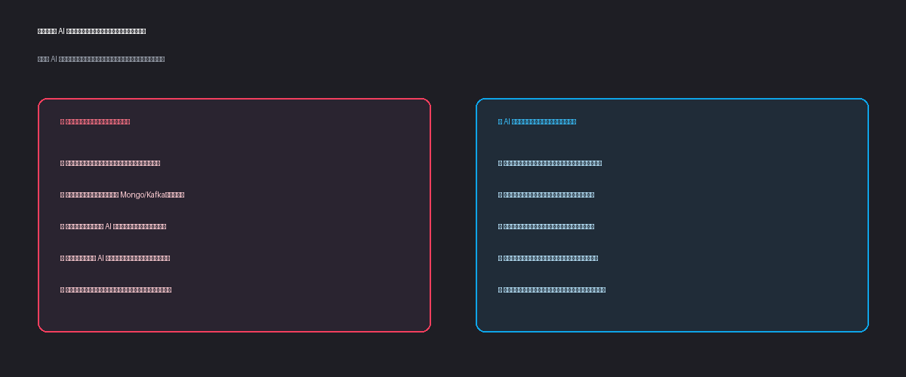
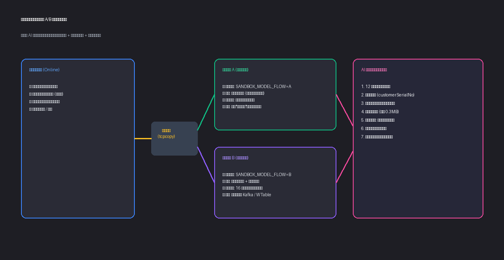
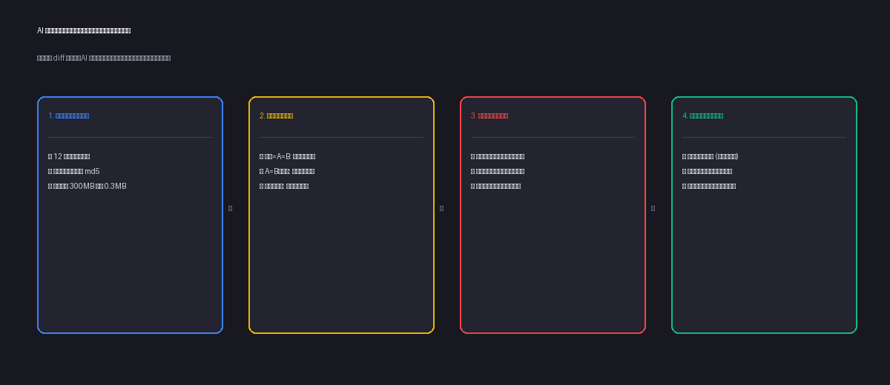

# 干了十几年 Java，我是如何让 AI 接管架构设计、线上排障和数据对账的？

> **TL;DR** 
> 网上谈 AI 提效，动辄是“教写小游戏”、“5 分钟写完 CRUD”或者“Prompt 语法大全”。对一个在生产环境摸爬滚打了十几年的 Java 老登来说，这些全是花架子。
> 
> 真实的业务系统往往是：几十万行祖传代码、没有文档、链路跨三五个微服务、日志一天几十 G，还有严格的线上权限审批与安全红线。
> 本文不聊虚的，梳理我**在真实生产研发中已经彻底常态化交给 AI 的 6 个硬核场景**：从让 AI 主笔写出无懈可击的技术设计、跨跳板机并发对账与自动排障，到环境变更自愈和代码图谱逆向工程。人负责定方向、做决策与守红线，AI 负责当体力和算力牛马。

---

## 为什么老工程师不爱看“Prompt 大全”？

工作年限越久，你越会发现：**工程师真正的核心竞争力，从来不是打字速度，而是“对上下文的理解”和“关键决策能力”。**

日常工作中，真正耗死我们的往往是这些体力与信息噪音：
- 接手一个没人讲得清的祖传服务，几十个类互相绕，光画链路图就要两天；
- 复杂重构方案要上评审，各种降级容灾、三方比对口径、回滚细则，写文档写到深夜；
- 生产环境流量回放与对账，要从多台跳板机拉几百兆日志比对几千个字段，查到眼睛酸痛；
- 发现某几条数据比对不一致，还要手动登机器敲一堆 `grep` 命令一层层查原因；
- 提测前补单测，各种 Mockito 构造参数，敲键盘敲到手抽筋。

从去年开始，我彻底重构了自己的工作流：**只要是不需要我背业务决策锅的“信息搬运、穷举与方案扩写”，全部交给 AI Agent。**

以下这 6 个场景，是我每天都在实打实用的真实落地。

---

## 场景 1：设计方案的颠覆——架构框架与防御方案全由 AI 产出，人只做“审判官”

**痛点**：  
很多工程师以为“写方案”必须自己逐字逐句画架构图、列时序、扣细节。一个核心重构方案，往往要写两三天，脑子里有想法，但敲成几十页严密规范的文档极其磨人。

**我的真实做法**：  
最近我在做一个**“16 个高频模型内层查询并发预拉取与扁平化”**的重大重构，涉及大量线上老链路与下游模型调用。  
在做方案时，**整篇技术方案的骨肉、架构图、环境防御机制和异常对比口径，全部是 AI 帮我写出来的**。我只负责给出最核心的方向定调和安全约束：
1. **我只给方向**：“我要把线上流量通过 `tcpcopy` 同时镜像到沙箱的两个节点。沙箱 A 跑老链路但强制只读缓存，沙箱 B 跑新链路强制缓存加并发预拉取。这样能同时对比线上、A、B 三方数据。”
2. **我只划红线**：“沙箱用了线上配置，绝对不能影响生产！你帮我想想怎么把写 Kafka、写 Mongo、写变量库的动作全部隔离掉；另外本地缓存更新怎么保留，防止配置刷新时产生干扰。”

**AI 帮我产出了什么？**  
半小时内，AI 扩写出了一份长达 9 个章节的保姆级完整技术设计文档：
- **画出了完整的时序与数据流转拓扑**；
- **制定了 8 类生产保护措施清单**（自动切断 Kafka 消费组、拦截短信告警、强制缓存置标）；
- **推导出了详尽的三方日志对比口径**（排除缓存时序噪音、模型探测日志、定义什么是真正的“不一致”）；
- **列出了完整的上线前还原与紧急回滚预案**。

> **人机分工本质**：我只花了 10 分钟定架构思路，花 5 分钟去跟产品和业务方确认诉求；AI 花了 20 分钟补齐了所有防御细节和文档；最后我以主审的身份审阅并拍板。方案拿去评审，同事和 Leader 都惊叹细节之周密。

---

## 场景 2：线上深水区——让 AI 连跳板机，做 12 组并发数据对账与“自动排查根因”

**痛点**：  
方案上线到沙箱后，怎么证明改造后的新代码和线上老代码结果完全一致？  
如果是人工对账，往往得一台台登跳板机、拉日志、写 Excel、用肉眼找不同。更痛苦的是：**一旦发现某个流水号的模型分不一致，你又得手动登录机器，一层层抓参数、查到底是哪个变量出了差错。**

**我的真实做法**：  
我把这项极其繁琐的工作，封装成了一个常态化的 **AI 对账技能（Agent Skill）**：
1. **全自动拉取与并发调度**：  
   AI 自动连入内网云平台，抓取当前 12 组对照实验的 Pod 真实 IP，发起 12 个组的并发流水线。
2. **轻量级指纹初筛（单台回传从 300MB 降至 0.3MB）**：  
   AI 远端下发轻量脚本，首轮只拉取打分结果和几千个变量入参的 MD5 指纹，单台传输耗时极低。
3. **发现不一致？AI 自动深入现场排查（核心杀手锏）**：  
   一旦初筛发现“线上、A、B 三方两两都不相同”：
   - **AI 不会直接把报错甩给我，而是自动触发二次登录**！
   - 根据该流水号，**自动补拉详细的内层模型入参、发送给模型平台的完整 JSON 请求体、以及模型调用轨迹**；
   - **自动关联工程源码排查**：比如它会定位到源码 `AbstractAsyncCommonImportor.java` 的某一行，分析出“由于沙箱环境偶发异步回调返回 null，导致该特征变量被兜底赋予默认值 -99”；
   - 区分出“真实逻辑 Bug”与“征信缓存时序环境噪音”。
4. **全自动格式化写入内部在线表格**：  
   对账结束后，AI 调用在线文档接口，自动把总览汇总、耗时对比和**异常流水号的不一致根因分析**，规整地写入内部在线协作表格，并自动处理网络重试与超时。

> **效果**：原本两个资深工程师要盯一整天的对账与排障体力活，现在只要敲一行回车让 AI 去跑，几分钟后打开在线表格，结论、明细与根因一览无余。

---

## 场景 3：环境变更与自愈——集群升级 IP 漂移？AI 自动感知并修复

**痛点**：  
大厂内部云平台经常搞滚动发布、蓝绿升级。源节点的 Pod 经常重建，IP 一旦变化，线上配好的流量镜像（tcpcopy）任务就会直接报错停止运行。运维或研发每天要手动去翻看哪个任务停了，再去云平台找新 Pod IP、删旧任务、填新任务。

**我的真实做法**：  
既然规则是确定的，直接做成 AI 自愈工作流：
- 告诉 AI：“某集群蓝绿升级 IP 变了，流量镜像停了，帮我恢复一下。”
- AI 自动打开云平台后台 ➔ 读取当前分组下所有处于 Running 状态的新 Pod 节点真实 IP ➔ 对比正在停止的旧任务 ➔ 自动下发删除旧任务请求 ➔ 自动提取新 IP 重新创建并启动镜像。

> **效果**：从原本需要登录控制台点 5 分钟的机械配置，变成了动动嘴皮子的一键自愈。

---

## 场景 4：接盘祖传黑盒——让代码图谱帮我“逆向工程”画出真实流转

**痛点**：  
接手别人的复杂老系统（几十万行代码、五年前写的、没有架构文档），表里几十个字段、状态枚举乱七八糟，几个接口在十几个 Service 里反复穿插。如果纯靠人工硬看，看两天还是一头雾水。

**我的真实做法**：  
把工程结构直接丢给具备代码图谱能力的 Agent（如基于 CodeGraph / 符号分析的工具）：
1. **逆向状态机**：给它数据库 DDL 和实体类，让它抓出所有更新这个状态字段的 Mapper/SQL，直接反推并画出一张 Mermaid 状态流转图。
2. **扒真实链路**：提问：“从入口方法进来，到最终落库，中间依次经过了哪些类？外部 RPC 调了谁？异步发了什么广播？”
3. **查隐藏陷阱**：让 AI 专门找“暗坑逻辑”，比如：“这个工程里是否有使用静态本地缓存？哪些地方使用了线程池但没有传递 TraceId 或上下文？”

> **效果**：以前新人接手核心模块需要啃一周代码，现在 AI 半小时把调用时序图、数据落库点、核心枚举分支整理成一份清晰的架构草稿，我只需要抽查关键节点确认。

---

## 场景 5：研发内循环——用真实线上上下文驱动单元测试，拒绝假跑

**痛点**：  
没有哪个后端喜欢写单测。尤其在大型企业工程下，一个 Service 往往注入了四五个 Mapper、三四个外部 RPC Client、外加 RedisTemplate。光是写 `Mockito.when(...).thenReturn(...)`、构造几百行入参数据，就能把人折磨疯，最后很多人为了应付指标只能假跑。

**我的真实做法**：  
我不让 AI 凭空捏造无意义的测试数据，而是**把线上排查的上下文与单测串联起来**：
1. 把某个线上出过问题的典型入参（脱敏后）直接喂给 AI；
2. 告诉它：“针对这个真实边界场景，写一个可重复运行的集成式单元测试，覆盖这个异常分支”；
3. 要求断言必须校验到关键返回字段和 Mock 对象的调用次数（`verify`），严禁假跑。

> **效果**：不仅能在本地随时复现线上极端时序，还能顺手把单测覆盖率拉高到 85% 以上，真正把单测变成了防御线上退化的安全网。

---

## 场景 6：打通浏览器最后一公里——让 AI 连接人和内部管理后台

**痛点**：  
作为后端工程师，除了写代码，日常还要应付大量内部系统的繁琐操作：每天去需求管理平台看工单、去审批中心提测、去配置平台改环境开关。步骤完全固定，纯属机械劳动。

**我的真实做法**：  
利用具备浏览器操控能力的 Agent（如 Claude in Chrome / CDP 浏览器自动化）：
- **自动抓取需求单**：丢一个需求工单链接给 AI，AI 自动唤起授权浏览器，登录后台提取需求背景、影响范围与字段定义，自动拆解成技术任务；
- **后台自动化批量操作**：在验证场景时，让 AI 自动打开测试管理后台，依次查询几组测试用户的状态，核对白名单是否生效，省去手动反复切换窗口复制粘贴。

---

## 总结：老工程师用 AI 的真实心法

摸索了这一整套深度工作流下来，我最大的感受只有三句话：

1. **别跟 AI 抢打字，也别跟 AI 抢搜日志**  
   它在**信息检索、格式转化、穷举测试、脚本编写**上的速度是人类肉眼的万倍以上。所有“耗时间但不需要承担责任”的体力活，坚决一件不留全部交出去。
2. **把关口守在“它不能乱拍板”的地方**  
   AI 没有生产责任概念，它不知道写错一个生产表会引发多大事故，不知道哪些接口涉及核心计费。**方案的路线抉择、安全红线的防御、业务需求的博弈、生产改动的终审，必须牢牢钉在人脑子里。**
3. **沉淀可复用的工程底座，比学 Prompt 语法值钱得多**  
   今天能让 AI 几分钟完成对账、查日志、写单测，核心不是因为我 Prompt 写得天花乱坠，而是因为我为它打通了**跳板机安全通道、代码图谱索引、在线文档 API** 这些坚固的“工程底座”。

工具永远在迭代，但真正懂生产、懂架构、懂业务边界的工程师，加上拉满的算力牛马，才是这个时代最可怕的研发效率。
